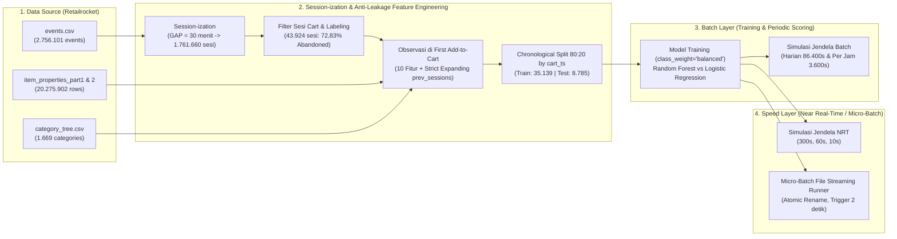

# WORKSHEET 4 (WS4) — Rancangan Teknis & Implementasi Pipeline Big Data
**Kelompok 15 — Teknologi Big Data**
- **Anggota:**
  1. Arief Adhitya Ramadhan (J0403241055)
  2. Muhammad Bafqi (J0403241018)
  3. Zidan Dzulqarnain (J0403241032)
- **Topik:** Analisis Deteksi Dini *Cart Abandonment* pada Platform E-Commerce Menggunakan Teknologi Big Data (Perbandingan Pemrosesan *Batch* vs. *Near Real-Time*)
- **Dataset:** Retailrocket E-Commerce Clickstream Dataset (`events.csv`, `item_properties_part1.csv`, `item_properties_part2.csv`, `category_tree.csv`)

---

## 1. Spesifikasi Lingkungan Implementasi (Hardware & Software Baseline)
Seluruh implementasi pipeline dijalankan dan diuji pada lingkungan lokal terisolasi (`.venv`) dengan spesifikasi terukur:
- **Prosesor (CPU):** 12th Gen Intel(R) Core(TM) i5-12450HX (8 Physical Cores, 12 Logical Threads)
- **Memori (RAM):** 11,78 GB
- **Sistem Operasi:** Windows 10 (Build 26300)
- **Runtime & Pustaka:** Python 3.11.9, `pandas` 3.1.1, `numpy` 2.4.6, `scikit-learn` 1.9.1, `matplotlib` 3.11.2
- **Waktu Eksekusi End-to-End Pipeline:** 53,0 detik (memproses 2.756.101 baris event dan 20.275.902 baris atribut produk)

---

## 2. Arsitektur Teknis Pipeline (Implementasi Lambda Architecture)

---

## 3. Rincian Tahapan Implementasi & Aturan Anti-Leakage

### Tahap 1: Session-ization dan Pelabelan Target
1. Timestamp milidetik dikonversi ke detik (`ts = timestamp // 1000`), lalu diurutkan berdasarkan `visitorid` dan `ts`.
2. Sesi baru (`session_id`) dibentuk apabila terjadi pergantian `visitorid` atau selisih waktu antar-event melebihi **30 menit (1.800 detik)**.
3. Dari **1.761.660 total sesi**, diambil seluruh sesi yang memiliki minimal satu aktivitas `addtocart` (**43.924 sesi**).
4. Sesi diberi label `abandoned = 1` jika tidak terdapat `transaction` di dalamnya (**31.992 sesi / 72,83%**), dan `abandoned = 0` jika terdapat transaksi (**11.932 sesi / 27,17%**).

### Tahap 2: Ekstraksi 10 Fitur pada Titik Observasi Dini (*First Add-to-Cart*)
Untuk memastikan tidak terjadi kebocoran masa depan (*data leakage*):
- Titik observasi ditetapkan pada event `addtocart` pertama (`cart_ts`) di setiap sesi. Semua aktivitas setelah `cart_row` diabaikan saat menghitung fitur perilaku.
- Fitur `prev_sessions` dihitung dengan algoritma *strict expanding window* (`np.searchsorted`), yaitu hanya menghitung sesi masa lalu milik `visitorid` yang sama yang telah selesai sebelum titik observasi saat ini ($\text{end\_ts}_{\text{prev}} < \text{cart\_ts}_{\text{current}}$).
- Pembagian data **Training (80% = 35.139 sesi)** dan **Testing (20% = 8.785 sesi)** diurutkan secara kronologis berdasarkan `cart_ts`.
- Imputasi median harga (`59.268,0`) dan *frequency encoding* kategori (`cat_freq`) dihitung murni pada data *Training* lalu dipetakan ke data *Testing*.

| No | Nama Fitur | Deskripsi Teknis | Mean (Completed) | Mean (Abandoned) | Gini Importance (RF) |
| :---: | :--- | :--- | :---: | :---: | :---: |
| 1 | `prev_sessions` | Jumlah sesi masa lalu pengunjung ($\text{end\_ts} < \text{cart\_ts}$) | 9.4421 | 2.1968 | **0.1995** |
| 2 | `elapsed_min` | Durasi (menit) dari awal sesi ke `addtocart` pertama | 8.8926 | 4.2550 | **0.1600** |
| 3 | `price_log` | $\ln(1 + \text{price})$ dari properti `790` | 11.0364 | 11.0910 | **0.1515** |
| 4 | `cat_freq` | Frekuensi kategori (`categoryid`) pada data *Train* | 221.2675 | 260.0601 | **0.1277** |
| 5 | `hour` | Jam terjadinya `addtocart` pertama (0–23 UTC) | 13.7849 | 12.8142 | 0.1016 |
| 6 | `n_views_same_item` | Jumlah *view* pada item yang sama sebelum masuk keranjang | 1.1796 | 0.9140 | 0.0811 |
| 7 | `dow` | Hari dalam minggu (0 = Senin s.d. 6 = Minggu) | 2.5246 | 2.7416 | 0.0593 |
| 8 | `n_events_before` | Total aktivitas dalam sesi hingga `addtocart` pertama | 3.7596 | 2.7215 | 0.0435 |
| 9 | `n_unique_items` | Jumlah produk unik yang dilihat sebelum `addtocart` pertama | 2.2710 | 1.6686 | 0.0397 |
| 10 | `n_views_before` | Total aktivitas `view` sebelum `addtocart` pertama | 2.7386 | 1.7215 | 0.0360 |

---

## 4. Hasil Evaluasi Model & Simulasi Arsitektur

### A. Perbandingan Model Klasifikasi (Data Uji Kronologis: 8.785 Sesi)

| Model | Precision | Recall | F1-Score | ROC-AUC | PR-AUC | Balanced Acc | Train Time (s) | Infer Latency (ms/row) |
| :--- | :---: | :---: | :---: | :---: | :---: | :---: | :---: | :---: |
| **Random Forest** | **0.8175** | 0.7095 | 0.7597 | **0.7030** | **0.8574** | **0.6389** | 1.0011 | 0.006635 |
| **Logistic Regression** | 0.8036 | **0.7487** | **0.7752** | 0.6829 | 0.8420 | 0.6250 | **0.0479** | **0.000228** |

### B. Hasil Simulasi Latensi Batch vs. Near Real-Time (Effective Recall)
Dengan batas waktu intervensi efektif $\text{deadline} = t_{\text{end}} + 1.800\text{ detik}$:

| Mode Pemrosesan | Jendela $W$ (s) | Mean Latency (s) | Median Latency (s) | Keputusan Sebelum Deadline (%) | TP Tepat Waktu | Effective Recall |
| :--- | :---: | :---: | :---: | :---: | :---: | :---: |
| **Batch Harian (24 Jam)** | 86,400 | 37,343.62 | 26,765.00 | 3.60% | 113 / 6,427 | **0.0176** |
| **Batch Per Jam (1 Jam)** | 3,600 | 1,792.34 | 1788.00 | 60.47% | 2,512 / 6,427 | **0.3909** |
| **Micro-Batch (5 Menit)** | 300 | 150.21 | 149.00 | **100.00%** | **4,560 / 6,427** | **0.7095** |
| **Near Real-Time (1 Menit)** | 60 | 30.51 | 30.00 | **100.00%** | **4,560 / 6,427** | **0.7095** |
| **Near Real-Time (10 Detik)** | 10 | 5.52 | 5.00 | **100.00%** | **4,560 / 6,427** | **0.7095** |

### C. Hasil Benchmark Micro-Batch Streaming (Trigger 2 Detik, 1.000 Sesi)
- **Mean End-to-End Latency:** `1,2735 detik`
- **Median ($P_{50}$) Latency:** `1,2596 detik`
- **Min / Max Latency:** `0,4980 detik` / `2,0766 detik`
- **Mean Batch Inference Time:** `28,9815 ms` per batch

---

## 5. Daftar Kode & Artefak di Workspace
1. **Modul Inti Anti-Leakage:** [src/pipeline_core.py](file:///c:/Bafqi/Big%20Data/src/pipeline_core.py)
2. **Script Eksperimen Utama:** [src/run_experiment.py](file:///c:/Bafqi/Big%20Data/src/run_experiment.py)
3. **Unit Test Verifikasi:** [tests/test_pipeline_core.py](file:///c:/Bafqi/Big%20Data/tests/test_pipeline_core.py)
4. **Ringkasan Metrik Lengkap (JSON & CSV):** [outputs/metrics_summary.json](file:///c:/Bafqi/Big%20Data/outputs/metrics_summary.json)
5. **Visualisasi 300 DPI Hitam-Putih:**
   - [outputs/figures/fig1_feature_importance.png](file:///c:/Bafqi/Big%20Data/outputs/figures/fig1_feature_importance.png)
   - [outputs/figures/fig2_temporal_patterns.png](file:///c:/Bafqi/Big%20Data/outputs/figures/fig2_temporal_patterns.png)
   - [outputs/figures/fig3_latency_effective_recall.png](file:///c:/Bafqi/Big%20Data/outputs/figures/fig3_latency_effective_recall.png)
6. **Draft Jurnal INISTA (SINTA 4):** [Draft_Jurnal_INISTA_Kelompok_15.md](file:///c:/Bafqi/Big%20Data/Draft_Jurnal_INISTA_Kelompok_15.md)
